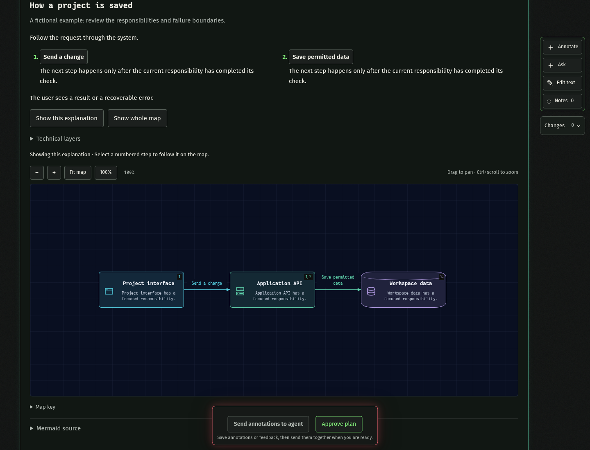

# Planboard

**Review an agent's plan before you build it.**

Planboard turns an existing Markdown plan into a local browser workspace with readable sections, interactive diagrams, anchored feedback, and revision history. Keep your planning method and your coding agent; use Planboard to understand the proposal, ask questions, and agree on the exact version to implement.



[Quick start](#quick-start) · [Install for your agent](https://github.com/lucapohl-angel/planboard/blob/main/docs/installation.md) · [Review workflow](https://github.com/lucapohl-angel/planboard/blob/main/docs/usage.md) · [Architecture](https://github.com/lucapohl-angel/planboard/blob/main/docs/architecture.md) · [Contributing](https://github.com/lucapohl-angel/planboard/blob/main/CONTRIBUTING.md)

[](https://github.com/lucapohl-angel/planboard/actions/workflows/ci.yml)

## What you can do

| Capability | How it helps |
| --- | --- |
| Markdown-first review | Keep the original document intact while the agent authors a readable presentation. |
| Interactive diagrams | Follow numbered explanations, inspect components and connections, and switch focused layers. |
| Ask and annotate | Ask about a selection, request alternatives, or attach a change request to exact text or a node. |
| Edit text directly | Correct supported text fields without a model call. |
| Compare revisions | Inspect changes, move the highlight baseline, and undo a revision when later edits do not conflict. |
| Approve an exact version | Save an immutable approved Markdown file and receipt. Approval does not start implementation. |

Planboard opens only when explicitly requested. It does not run a planning hook on every prompt, impose a planning template, or replace your agent's existing workflow.

## Quick start

Use **Node.js 24+**. For Pi, install the package directly:

```bash
pi install npm:@koboimomo/planboard
```

Run `/reload`, then `/planboard` in your project. The package includes the extension and skill.

For Claude Code or Codex:

```bash
npm install -g @koboimomo/planboard

# Claude Code
planboard install-skill --agent claude
claude mcp add --scope user --transport stdio planboard -- planboard mcp

# Or Codex
planboard install-skill --agent codex
codex mcp add planboard -- planboard mcp
```

Restart the agent, then invoke `/planboard` in Claude Code or `$planboard` in Codex. Install only the integration you use. [Installation, updates, and source setup](https://github.com/lucapohl-angel/planboard/blob/main/docs/installation.md).

### Try the fictional demo

```bash
git clone https://github.com/lucapohl-angel/planboard.git
cd planboard
npm ci
npm run demo
```

Open the printed URL. The demo runs without an agent in a temporary project; Ctrl+C stops it. Feedback stays queued until an agent is attached.

## Choose your agent

| Agent | Connection | Start a review |
| --- | --- | --- |
| Claude Code | Skill + local stdio MCP server | `/planboard` or `/planboard plans/release.md` |
| Codex | Skill + local stdio MCP server | `$planboard` with the draft or Markdown path |
| Pi | Native package extension + skill | `/planboard` or `/planboard plans/release.md` |
| Other local agents | Standard MCP tools + the supplied instructions | Explicitly request a Planboard review |

The browser, files, and review contract are shared. MCP hosts must keep a `wait` loop active to receive feedback; use a background agent when your host supports it. An idle MCP host cannot be assumed to wake automatically. Pi can deliver follow-ups to its owning session. See [connection behavior and recovery](https://github.com/lucapohl-angel/planboard/blob/main/docs/usage.md).

The standard MCP workflow uses your chosen host agent. The optional fast Codex subprocess adapter is opt-in and has additional model requirements; it is not needed to use Planboard.

## Draft → review → revise → approve


1. Draft a plan using your preferred method. If it exists only in the conversation, the agent saves that public draft as Markdown first.
2. Invoke Planboard. The agent preserves the source and opens a readable review.
3. Explore the diagrams, ask questions, compare alternatives, or request changes. Notes retain their target and original revision.
4. Review the update. The viewer preserves active drafts and shows committed changes; failed requests remain retryable.
5. Approve the displayed revision when ready. The agent receives the approved file and asks separately whether to implement it.

## Files stay with the project

Review records live under `<project>/.pi/plans/` for compatibility, even when you use Claude Code or Codex. That directory contains revisions, feedback, the immutable original source, and the reviewed Markdown. Approval writes a versioned Markdown artifact and SHA-256 receipt. The legacy `plan.md` review export includes history; use the approved artifact for implementation.

The local server binds to loopback. Browser feedback sent to an agent follows that agent's provider policy. Do not expose the server as a public service. [Security and data boundaries](https://github.com/lucapohl-angel/planboard/blob/main/SECURITY.md)

## Use it with Formative

[Formative](https://github.com/lucapohl-angel/formative) helps discover what an app needs through persistent interviewing and prototype checkpoints. Planboard helps review the resulting plan. You can use either on its own or bring Formative's written plan into Planboard; neither package imports or requires the other.

## Development and limits

From a source checkout:

```bash
npm run test:unit
npx playwright install chromium
npm run test:browser
npm run check:release
```

Tests cover persistence, stale revisions, source preservation, MCP feedback/reconnection, browser interaction, and accessibility checks. Optional native Pi integration tests need an installed Pi runtime. CI is configured for Linux; macOS and Windows installation commands are provided but are not yet end-to-end tested. Protocol tests do not guarantee an agent's reasoning quality.

This is an early public release of a local single-user tool. Structural validation cannot prove that a plan is feasible, secure, or complete. Direct editing covers text fields, not arbitrary structural changes. Undo can be blocked by conflicting later edits. See [usage and limits](https://github.com/lucapohl-angel/planboard/blob/main/docs/usage.md).

**License:** [MIT](https://github.com/lucapohl-angel/planboard/blob/main/LICENSE). Third-party dependencies retain their own licenses. Public examples and screenshots are fictional.
